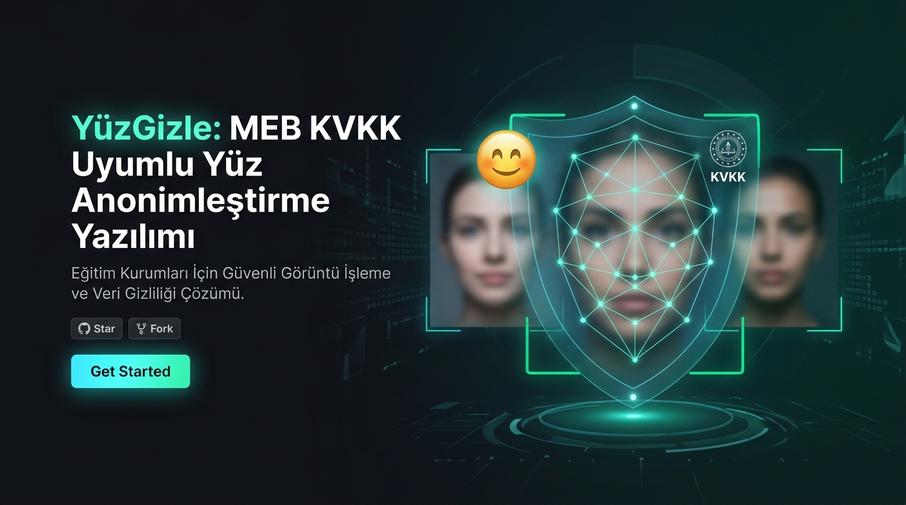
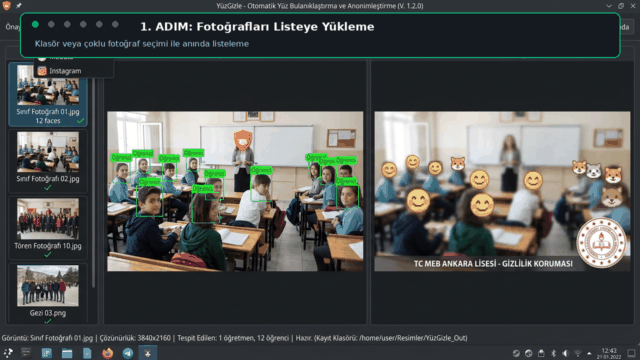
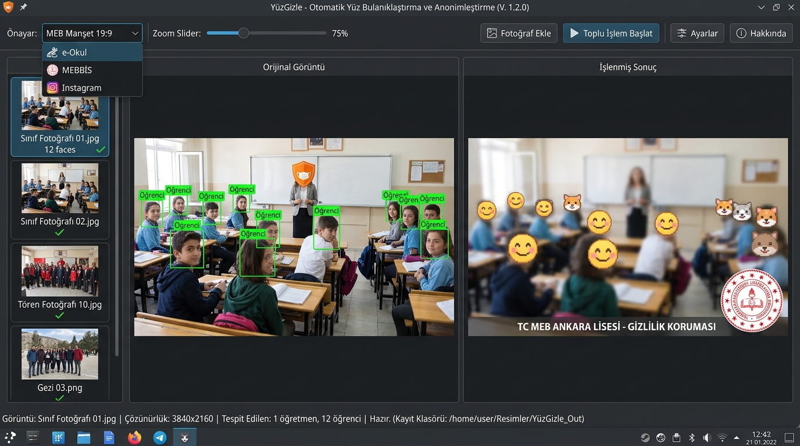
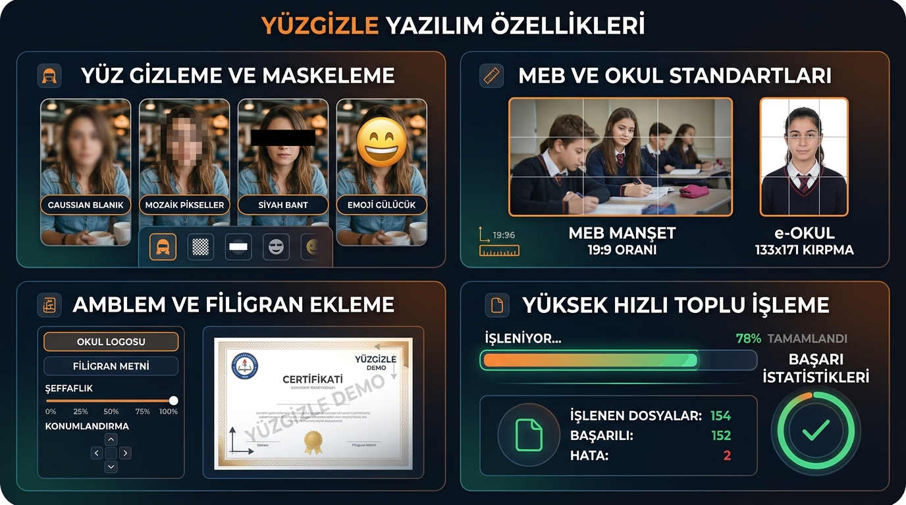

<p align="center">
  
</p>

<p align="center">
  <a href="https://github.com/"></a>
  <a href="https://www.qt.io/"></a>
  <a href="https://opencv.org/"></a>
  <a href="#"></a>
  <a href="#"></a>
  <a href="#"></a>
</p>

<h1 align="center">🎓 YüzGizle (FaceHide)</h1>

<p align="center">
  <b>Millî Eğitim Bakanlığı (MEB)</b> okullarının web sitelerine (<code>*.meb.k12.tr</code>), <b>MEBBİS / e-Okul</b> sistemlerine ve sosyal medya hesaplarına yüklenecek etkinlik fotoğraflarında öğrenci yüzlerini <b>6698 sayılı Kişisel Verilerin Korunması Kanunu (KVKK)</b> kapsamında yapay zeka ile otomatik, toplu ve güvenli olarak anonimleştiren, okul logosu ve filigran ekleyen profesyonel masaüstü uygulamasıdır.
</p>

<p align="center">
  <a href="https://github.com/HIbrahimK/yuztanima/releases/latest"></a>
  <a href="https://github.com/HIbrahimK/yuztanima/releases"></a>
</p>

---

## 📥 Hazır Sürümü İndir (Releases — Derleme / Kod Gerektirmez)

> [!TIP]
> **Öğretmenler, İdareciler ve Son Kullanıcılar İçin:**
> Uygulamayı çalıştırmak için **kaynak kodları indirmenize, terminal kullanmanıza veya derleme yapmanıza kesinlikle gerek yoktur.** Aşağıdaki tablodan işletim sisteminize uygun hazır paketi indirip hemen kullanabilirsiniz.

| İşletim Sistemi | Paket Formatı | İndirme Bağlantısı | Boyut | Durum |
| :--- | :--- | :--- | :--- | :--- |
| 🐧 **Linux (Tüm Dağıtımlar)** | Taşınabilir (Portable .tar.gz) | [📦 **YuzGizle-v1.0.0-Linux-x86_64.tar.gz**](https://github.com/HIbrahimK/yuztanima/releases/latest) | ~524 KB | 🟢 **Yayında** |
| 🪟 **Windows 10 / 11 (64-bit)** | Taşınabilir (.zip) | [📦 **YuzGizle-v1.0.0-Windows-x64.zip**](https://github.com/HIbrahimK/yuztanima/releases/latest) | Yakında | 🟡 **Hazırlanıyor** |

### ⚡ 3 Adımda Kolay Kurulum ve Çalıştırma:
1. **İndirin:** Yukarıdaki tablodan veya [GitHub Releases](https://github.com/HIbrahimK/yuztanima/releases/latest) sayfasından `YuzGizle-v1.0.0-Linux-x86_64.tar.gz` dosyasını bilgisayarınıza indirin.
2. **Arşivden Çıkartın:** İndirilen dosyaya sağ tıklayın ve **"Buraya Çıkart"** (Extract Here) seçeneğini seçin.
3. **Çift Tıklayıp Başlatın:** Klasörün içindeki **`baslat.sh`** dosyasına çift tıklayın! (Gerekirse terminalden `./baslat.sh` ile çalıştırabilirsiniz).

---

## 🎬 Canlı Kullanım Demosu (Önizleme Videosu)

<p align="center">
  
</p>

<p align="center">
  🍿 <b>Yüksek Kaliteli Video:</b> <a href="docs/screenshots/demo.mp4"><b>▶️ demo.mp4 (Tam Boyutlu Kullanım Videosunu İndir / İzle)</b></a>
</p>

---

## 📸 Uygulama Arayüzü & Ekran Görüntüleri

### 🖥️ Ana Çalışma Alanı (Etkileşimli Tuval & Canlı Önizleme)
<p align="center">
  
</p>

### 🧩 Temel Özellikler & Standartlar Kolajı
<p align="center">
  
</p>

---

## ✨ Öne Çıkan Özellikler

### 1. 🔍 Derin Öğrenme Destekli Yüz Algılama (YuNet & Haar)
- **OpenCV YuNet (ONNX / DNN):** Profil, eğik, kısmen dönük veya gölgede kalmış yüzleri dahi yüksek doğrulukla ve milisaniyeler içinde tespit eder.
- **Haar Cascade:** Eski veya düşük donanımlı okul bilgisayarları için hızlı alternatif motor.
- **Dinamik Eşik Ayarı:** Algılama güven eşiği (%10 - %95) ve minimum piksel boyutu arayüzden ayarlanabilir.

### 2. 🛡️ Etkileşimli Yüz Seçimi & Öğretmen/İdareci Muafiyeti
- **Tek Tıkla Muafiyet:** Orijinal görüntü tuvalindeki yüz kutusuna tıklayarak öğretmen veya okul idarecilerini gizlemeden muaf tutabilirsiniz (`🛡️ Muaf (Öğretmen)` turuncu kesikli çerçeve).
- **➕ Manuel Gizleme Alanı Ekleme:** Fareyle sürükleyip dikdörtgen çizerek yapay zekanın kaçırdığı profil yüzleri veya hassas okul rozetlerini ekleyebilirsiniz (`[M]` rozeti).
- **Sağ Tık Bağlam Menüsü:** Tek tıkla *"Tümünü Gizle"*, *"Tümünü Muaf Tut"* veya *"Manuel Alanı Sil"*.
- **Canlı Yüz İstatistiği:** Toplam yüz sayısı, gizlenecek öğrenci sayısı ve muaf personel sayısını gösteren canlı durum paneli.

### 3. 📐 MEB & Sosyal Medya Hazır Standartları
| Standart Şablon | Piksel Ölçüsü | En-Boy Oranı | Dosya Boyutu Kuralı | Açıklama |
|---|:---:|:---:|:---:|---|
| **📰 MEB Manşet Haberi** | **1200 × 568 px** | **19:9** | Standart JPEG / PNG | `*.meb.k12.tr` web sitelerinin güncel zorunlu manşet standardı |
| **🎓 MEB e-Okul** | **133 × 171 px** | 35:45 (Vesikalık) | **< 20 KB (Zorunlu)** | e-Okul sistemi için otomatik boyut ve kalite optimizasyonu |
| **🏛️ MEBBİS Vesikalık** | **394 × 512 px** | Yüksek Çözünürlük | Otomatik Sıkıştırma | MEBBİS personel ve öğrenci kayıt sistemleri profil standardı |
| **📷 Instagram Kare** | **1080 × 1080 px** | 1:1 (Kare) | Web Kalitesi | Instagram ve Facebook akış paylaşımları |
| **📱 Instagram Dikey** | **1080 × 1350 px** | 4:5 (Portre) | Web Kalitesi | Instagram dikey gönderi formatı |
| **🎬 Instagram Reels** | **1080 × 1920 px** | 9:16 (Dikey) | Web Kalitesi | Instagram Reels, Hikaye (Story) ve TikTok paylaşımları |
| **📐 Özel Boyutlandırma** | Kullanıcı Tanımlı | Serbest / Kilitli | Kullanıcı Seçimli | Serbest piksel genişlik ve yükseklik girişi |

### 4. 🏫 Okul Logosu ve Kurumsal Filigran Motoru (Tekil & Toplu)
- **Şeffaf PNG / SVG Logosu:** Okulunuzun resmi amblemini fotoğrafların üzerine dilediğiniz ölçekte ekler.
- **Kurumsal Metin Filigranı:** *"T.C. Millî Eğitim Bakanlığı"*, okul adı gibi metinleri otomatik yerleştirir.
- **Konum Seçenekleri:** Sağ Alt (Standart Kurumsal), Sol Alt, Sağ Üst, Sol Üst ve Merkez.
- **Opaklık ve Boyut:** %10 - %100 saydamlık ve %5 - %40 logo boyutu slider kontrolleri.
- **Kontrast Kapsülü:** Her türlü açık veya koyu arka planda logonun ve metnin net okunabilmesi için estetik yarı saydam kontrast bandı.
- **Canlı Önizleme:** Logo ve metin hem önizlemede anında görülür hem de toplu işlemde tüm fotoğraflara otomatik basılır.

### 5. 🎭 Zengin Gizleme Yöntemleri
- **Gaussian Blur (Bulanıklaştırma):** Ayarlanabilir yumuşak veya yoğun bulanıklık (kernel: 15-99).
- **Pikselleştirme (Mozaik):** Klasik piksel sansürleme efekti (blok boyutu: 4-40).
- **Siyah Bant:** Göz hizasında otomatik opak güvenlik bandı.
- **Emoji / Smiley Kaplama:** Hazır şirin emoji galerisi (`😊`, `😎`, `🙂`, `⭐`, `😄`, `😷`) veya özel PNG yükleme desteği.

### 6. 📦 Yüksek Performanslı Toplu İşleme Motoru
- **Çok Çekirdekli İş Parçacığı (`QThread`):** Arayüzü dondurmadan arka planda yüzlerce fotoğrafı saniyeler içinde işler.
- **İptal & Durdurma:** İşlem devam ederken tek tıkla güvenli durdurabilme (`⏹️ İşlemi Bitir`).
- **Detaylı Raporlama:** İşlem sonunda başarı, hata ve yüz bulunamayan fotoğrafların tam raporu.

---

## ⌨️ Fare ve Klavye Kısayolları

| Kısayol | Eylem |
|---|---|
| **Fare Tekerleği (Scroll)** | Fotoğrafı akıcı şekilde yakınlaştır / uzaklaştır (%20 – %300) |
| **Fare Sol Tık + Sürükle (Boş Alanda)** | Fotoğrafı tuval içinde el aracı (Pan) gibi serbestçe kaydır |
| **Sol Tık (Yüz Kutusuna)** | Öğrenci gizleme ile Öğretmen/İdareci muafiyeti arasında geçiş yap |
| **CTRL + Fareyle Sürükle** | Kaçan yüzler veya hassas alanlar için anında **Yeni Manuel Alan** çiz |
| **SHIFT + Tık (Yüze/Alana)** | Seçili yüz kutusunu veya manuel alanı anında sil |
| **F5** | Toplu işlemi başlat |
| **ESC** | Devam eden toplu işlemi durdur |

---

## 🛠️ Sistem Gereksinimleri

- **İşletim Sistemi:** Linux (Ubuntu 20.04+, Debian, Fedora, Arch, CachyOS) veya Windows 10/11
- **Derleyici:** C++17 destekli modern derleyici (GCC 9+, Clang 11+, MSVC 2019+)
- **Qt Framework:** Qt 6.5+ (Widgets, Core, Gui, Concurrent, Test, LinguistTools)
- **OpenCV:** OpenCV 4.8+ veya 5.0+ (core, imgproc, imgcodecs, objdetect, dnn, xobjdetect)
- **CMake:** 3.22 veya üzeri

---

## 🚀 Kurulum ve Derleme

### 1. Depoyu Klonlayın
```bash
git clone https://github.com/HIbrahimK/yuztanima.git
cd yuztanima
```

### 2. Model Dosyalarını İndirin
```bash
chmod +x scripts/download_models.sh
./scripts/download_models.sh
```

### 3. Projeyi Derleyin
```bash
# Debug modunda derleme ve birim testleri çalıştırma:
./scripts/build.sh debug

# Veya Release modunda yüksek performanslı derleme:
./scripts/build.sh
```

### 4. Uygulamayı Başlatın
```bash
./build/bin/YuzGizle
```

---

## 🧪 Birim Testler (Unit Tests)

Projede yer alan algılama, MEB boyutlandırma, dosya boyutu sınırlayıcı ve logo filigran fonksiyonları QtTest ile test edilmektedir:

```bash
./build/bin/test_core
```

```text
********* Start testing of TestCore *********
Config: Using QtTest library 6.12.0
PASS   : TestCore::initTestCase()
PASS   : TestCore::testGaussianBlurStrategy()
PASS   : TestCore::testPixelateStrategy()
PASS   : TestCore::testBlackBarStrategy()
PASS   : TestCore::testEmojiOverlayStrategy()
PASS   : TestCore::testBatchResultStats()
PASS   : TestCore::testImageUtilsConversion()
PASS   : TestCore::testFaceDetectionYuNet()
PASS   : TestCore::testBatchProcessorRun()
PASS   : TestCore::testBatchProcessorRunWithEmoji()
PASS   : TestCore::testMebMansetPreset()          -> 1200x568 (19:9) Testi Başarılı
PASS   : TestCore::testEOkulPresetAndSize()       -> 133x171 & < 20 KB Testi Başarılı
PASS   : TestCore::testMebbisPreset()             -> 394x512 Testi Başarılı
PASS   : TestCore::testInstagramPresets()         -> 1080x1080, 1080x1350, 1080x1920 Başarılı
PASS   : TestCore::testWatermarkTextAndLogo()     -> Logo & Metin Filigran Başarılı
PASS   : TestCore::testBatchProcessorWithManualOverrides()
PASS   : TestCore::testMaxFileSizeConstraintQualityOnly()
PASS   : TestCore::testMaxFileSizeConstraintCompressAndResize()
PASS   : TestCore::cleanupTestCase()
Totals: 19 passed, 0 failed, 0 skipped, 0 blacklisted
********* Finished testing of TestCore *********
```

---

## 📁 Proje Dizin Yapısı

```
yuztanima/
├── CMakeLists.txt              # Ana CMake derleme yapılandırması
├── proje_plani.md              # Detaylı mimari ve aşama planı
├── README.md                   # Resimli GitHub dokümantasyonu
├── docs/                       # Ekran görüntüleri, banner ve tanıtım videosu
│   └── screenshots/
│       ├── banner_hero.jpg     # 4K GitHub repository ana afişi
│       ├── app_interface.jpg   # Kullanıcı arayüzü ekran görüntüsü
│       ├── features_showcase.jpg # Özellik ve şablon kolajı
│       ├── demo.gif            # Canlı animasyonlu README demosu
│       └── demo.mp4            # Yüksek çözünürlüklü tanıtım videosu
├── resources/                  # Uygulama kaynakları
│   ├── emojis/                 # Sansür kaplama emojileri
│   ├── icons/                  # Uygulama amblemi ve ikonlar
│   ├── models/                 # YuNet ONNX ve Haar Cascade modelleri
│   └── resources.qrc           # Qt Resource sistemi
├── scripts/                    # Yardımcı otomasyon betikleri
│   ├── build.sh                # Otomatik derleme betiği
│   ├── download_models.sh      # ONNX yapay zeka modeli indirici
│   └── generate_demo_assets.py # Tanıtım videosu ve görsel üretici
├── src/                        # Kaynak kodlar
│   ├── main.cpp                # Uygulama giriş noktası
│   ├── core/                   # Yüz algılama, gizleme ve toplu işlem motoru
│   ├── gui/                    # Qt 6 arayüz bileşenleri (Tuval, Önizleme, Diyaloglar)
│   └── utils/                  # Boyutlandırma, filigran, dosya ve ayar yöneticisi
└── tests/                      # Birim test paketi (QtTest)
```

---

## 🚀 Gelecek Yol Haritası (Roadmap)

- [ ] **🎬 Instagram & Sosyal Medya Kaliteli Video / Slayt Şovu Oluşturucu:**
  - Anonimleştirilmiş ve logolanmış fotoğraflardan Instagram Reels, Hikaye ve Gönderiler için akıcı geçiş efektli dikey (1080×1920, 9:16) video slayt şovları üretimi.
  - Arka plan müziği veya ses kaydı ekleme (MP3, WAV, AAC ses kanalı miksajı).
  - FFmpeg / OpenCV `cv::VideoWriter` ile yüksek kaliteli H.264 video kodlama.
- [ ] **📄 PDF ve Word (.docx) Belge Dönüştürücü:**
  - Okul bültenleri, taranmış resmi evraklar ve belgelerdeki sayfaları doğrudan yüksek çözünürlüklü resimlere dönüştürme.
  - Belgeler içerisindeki fotoğrafları yapay zeka ile bulup yüz gizleme ve okul logosu ekleme sürecine dahil etme.
- [ ] **🎯 MEBBİS & e-Okul Akıllı Vesikalık Kırpma Sihirbazı:**
  - Toplu sınıf ve mezuniyet fotoğraflarından yapay zeka ile öğrenci yüzünü tespit edip 35×45 mm vesikalık baş/omuz payıyla otomatik ortalama.
  - Tek tıkla e-Okul için **133 × 171 px (< 20 KB)** veya MEBBİS için **394 × 512 px** vesikalıklar halinde dışa aktarma.

---

## ⚖️ Lisans ve Yasal Uyarı

Bu proje Millî Eğitim Bakanlığı'na bağlı okulların ve eğitim kurumlarının **6698 sayılı Kişisel Verilerin Korunması Kanunu (KVKK)** gerekliliklerine uyumunu kolaylaştırmak amacıyla açık kaynak olarak geliştirilmiştir.