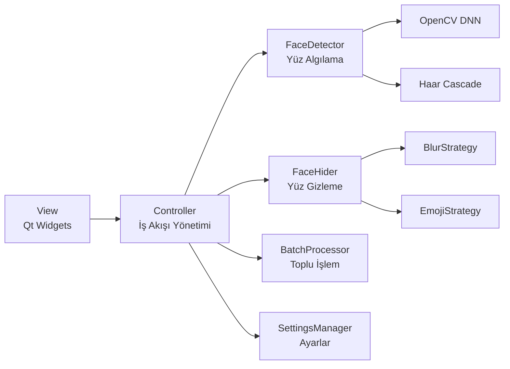
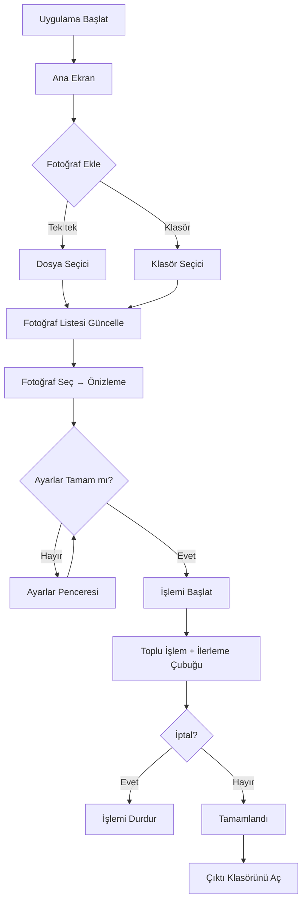
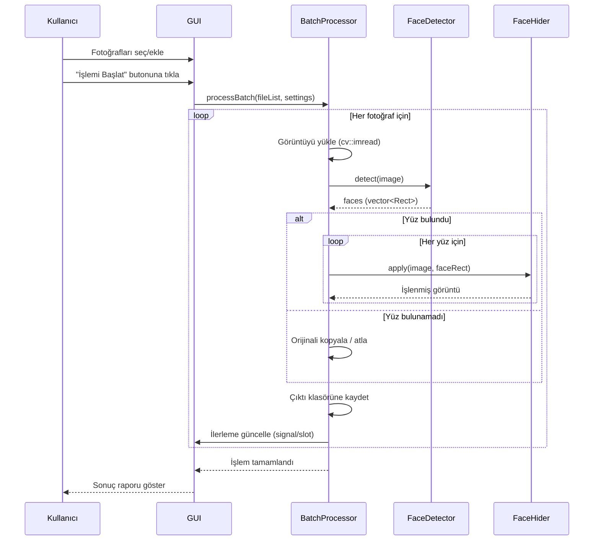
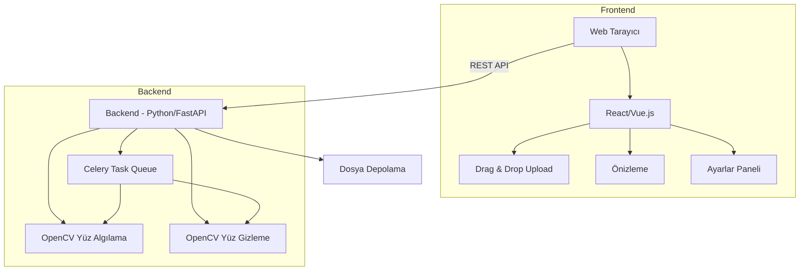

# 🎓 MEB Yüz Gizleme Uygulaması — Ayrıntılı Proje Planı

> **Proje Adı:** YüzGizle (FaceHide)
> **Amaç:** MEB'e bağlı okulların web sitelerine (*.meb.k12.tr) yüklenecek etkinlik fotoğraflarında öğrenci yüzlerini KVKK kapsamında otomatik olarak gizlemek.
> **Teknoloji:** C++ / Qt 6 / OpenCV / CMake
> **Platformlar:** Windows 10/11, Linux (Ubuntu/Debian/Fedora)

---

## 📋 İçindekiler

1. [Proje Genel Bakış](#1-proje-genel-bakış)
2. [Teknik Mimari](#2-teknik-mimari)
3. [Modül Yapısı](#3-modül-yapısı)
4. [Arayüz Tasarımı (GUI)](#4-arayüz-tasarımı-gui)
5. [Yüz Tanıma Motoru](#5-yüz-tanıma-motoru)
6. [Yüz Gizleme Yöntemleri](#6-yüz-gizleme-yöntemleri)
7. [Toplu İşlem Sistemi](#7-toplu-işlem-sistemi)
8. [Ayarlar ve Yapılandırma](#8-ayarlar-ve-yapılandırma)
9. [Çoklu Dil Desteği (i18n)](#9-çoklu-dil-desteği-i18n)
10. [Dizin & Dosya Yapısı](#10-dizin--dosya-yapısı)
11. [Geliştirme Aşamaları](#11-geliştirme-aşamaları)
12. [Build & Dağıtım](#12-build--dağıtım)
13. [Test Stratejisi](#13-test-stratejisi)
14. [Gelecek Planları (Web Sürümü)](#14-gelecek-planları-web-sürümü)
15. [Riskler ve Çözüm Önerileri](#15-riskler-ve-çözüm-önerileri)
16. [MEB KVKK Standartları & Gelişmiş Özellikler (Tamamlandı)](#16-meb-kvkk-standartları--gelişmiş-özellikler-tamamlandı-)
17. [Gelecek Yol Haritası (Roadmap): Video & Belge Dönüştürme](#17-gelecek-yol-haritası-roadmap-video-oluşturma--belge-dönüştürme)

---

## 1. Proje Genel Bakış

### 1.1 Problem
Milli Eğitim Bakanlığı'na bağlı okullar, düzenledikleri etkinliklerin haberlerini `*.meb.k12.tr` uzantılı web sitelerine yüklüyor. KVKK (6698 sayılı Kişisel Verilerin Korunması Kanunu) kapsamında, öğrencilerin yüzleri açıkça görünmemeli. Öğretmenler teknik bilgi gerektirmeyen, hızlı bir çözüme ihtiyaç duyuyor.

### 1.2 Çözüm
Toplu fotoğraf işleme yapabilen, yüzleri otomatik algılayıp bulanıklaştıran veya emoji ile kaplayan masaüstü uygulaması.

### 1.3 Hedef Kullanıcı Profili
- Okul yöneticileri ve bilişim öğretmenleri
- Teknik bilgisi sınırlı kullanıcılar
- Windows ve Linux kullanıcıları

### 1.4 Temel Özellikler

| Özellik | Açıklama |
|---------|----------|
| 🔍 Yüz Algılama | OpenCV DNN + Haar Cascade (kullanıcı seçimli) |
| 🌫️ Bulanıklaştırma | Gaussian blur, pixelate, siyah bant |
| 😊 Emoji Kaplama | Hazır smiley seti + özel emoji yükleme |
| 📦 Toplu İşlem | Yüzlerce fotoğrafı tek seferde işleme |
| 👁️ Önizleme | İşlenmeden önce sonucu görme |
| ⚙️ Ayarlar | Gizleme yöntemi, algılama hassasiyeti, dil seçimi |
| 🌐 Çoklu Dil | Türkçe + İngilizce |
| 💾 Güvenli Kayıt | Orijinal dosyalara dokunmadan ayrı klasöre kayıt |

---

## 2. Teknik Mimari

### 2.1 Teknoloji Yığını

```
┌─────────────────────────────────────────────────┐
│                    GUI Katmanı                   │
│              Qt 6 Widgets / QML                  │
├─────────────────────────────────────────────────┤
│                 İş Mantığı Katmanı               │
│          C++17 (Controller / Service)            │
├──────────────────┬──────────────────────────────┤
│   Yüz Algılama   │    Görüntü İşleme           │
│   OpenCV DNN     │    OpenCV imgproc            │
│   Haar Cascade   │    Blur / Overlay            │
├──────────────────┴──────────────────────────────┤
│              Platform Soyutlama                  │
│        Qt 6 (Dosya I/O, Thread, i18n)           │
├─────────────────────────────────────────────────┤
│           İşletim Sistemi (Win/Linux)            │
└─────────────────────────────────────────────────┘
```

### 2.2 Bağımlılıklar

| Kütüphane | Sürüm | Kullanım Amacı |
|-----------|-------|----------------|
| Qt 6 | 6.5+ | GUI framework, i18n, dosya işlemleri, multithreading |
| OpenCV | 4.8+ | Yüz algılama (DNN, Haar), görüntü işleme |
| CMake | 3.22+ | Build sistemi |
| spdlog | 1.12+ | Loglama (opsiyonel) |

### 2.3 Mimari Desen

**Model-View-Controller (MVC)** benzeri yapı:



---

## 3. Modül Yapısı

### 3.1 Core Modüller

#### 3.1.1 `FaceDetector` — Yüz Algılama Modülü
```
Sorumluluklar:
├── Strateji seçimi (DNN / Haar Cascade)
├── Yüz bounding box'larını döndürme
├── Güven eşiği (confidence threshold) ayarı
├── Çoklu yüz desteği
└── Performans optimizasyonu (resize & detect)
```

**Sınıf Hiyerarşisi:**
```cpp
// Soyut arayüz
class IFaceDetector {
public:
    virtual ~IFaceDetector() = default;
    virtual std::vector<cv::Rect> detect(const cv::Mat& image) = 0;
    virtual void setConfidenceThreshold(float threshold) = 0;
};

// DNN tabanlı algılayıcı
class DnnFaceDetector : public IFaceDetector { ... };

// Haar Cascade tabanlı algılayıcı
class HaarFaceDetector : public IFaceDetector { ... };

// Factory
class FaceDetectorFactory {
    static std::unique_ptr<IFaceDetector> create(DetectorType type);
};
```

#### 3.1.2 `FaceHider` — Yüz Gizleme Modülü
```
Sorumluluklar:
├── Gizleme stratejisi uygulama
│   ├── Gaussian Blur
│   ├── Pixelate (mozaik)
│   ├── Siyah bant
│   └── Emoji kaplama
├── Gizleme alanını yüz boyutuna göre ölçekleme
├── Emoji/sticker yükleme ve yönetimi
└── Özel emoji dosyası desteği
```

**Strateji Deseni:**
```cpp
class IHidingStrategy {
public:
    virtual ~IHidingStrategy() = default;
    virtual void apply(cv::Mat& image, const cv::Rect& faceRect) = 0;
    virtual QString name() const = 0;
};

class GaussianBlurStrategy : public IHidingStrategy { ... };
class PixelateStrategy : public IHidingStrategy { ... };
class BlackBarStrategy : public IHidingStrategy { ... };
class EmojiOverlayStrategy : public IHidingStrategy { ... };
```

#### 3.1.3 `BatchProcessor` — Toplu İşlem Modülü
```
Sorumluluklar:
├── Dosya listesi yönetimi (ekleme, çıkarma)
├── Çoklu iş parçacığı (QThreadPool) ile paralel işleme
├── İlerleme takibi ve raporlama
├── İptal mekanizması
├── Hata yönetimi (bozuk dosya, erişim hatası vb.)
└── Çıktı klasörü yönetimi
```

#### 3.1.4 `SettingsManager` — Ayarlar Modülü
```
Sorumluluklar:
├── Kullanıcı tercihlerini kaydetme/yükleme (QSettings)
├── Varsayılan ayarlar
├── Algılama yöntemi seçimi
├── Gizleme yöntemi seçimi
├── Blur yoğunluğu / Piksel boyutu
├── Emoji seçimi
├── Güven eşiği
├── Çıktı klasörü ayarı
├── Dil seçimi
└── JPEG kalitesi
```

#### 3.1.5 `ImagePreview` — Önizleme Modülü
```
Sorumluluklar:
├── Orijinal ve işlenmiş görüntüyü yan yana gösterme
├── Zoom in/out
├── Yüz kutucuklarını gösterme (algılanan yüzler)
├── Manuel yüz seçimi / düzeltme (bonus)
└── Slayt gösterisi ile toplu önizleme
```

---

## 4. Arayüz Tasarımı (GUI)

### 4.1 Ana Pencere Düzeni

```
┌─────────────────────────────────────────────────────────────────┐
│  📷 YüzGizle  │  Dosya  │  Düzenle  │  Ayarlar  │  Yardım     │ ← Menü çubuğu
├─────────────────────────────────────────────────────────────────┤
│ [📁 Fotoğraf Ekle] [📂 Klasör Ekle] [▶ İşlemi Başlat] [⚙️]   │ ← Araç çubuğu
├────────────────────┬────────────────────────────────────────────┤
│                    │                                            │
│   📋 Fotoğraf      │          👁️ Önizleme Alanı                │
│   Listesi          │                                            │
│                    │    ┌──────────┐    ┌──────────┐           │
│   ☑ foto1.jpg      │    │ Orijinal │    │ İşlenmiş │           │
│   ☑ foto2.jpg      │    │          │    │          │           │
│   ☑ foto3.jpg      │    │  [yüz]   │    │  [blur]  │           │
│   ☑ foto4.jpg      │    │          │    │          │           │
│   ☐ foto5.jpg      │    └──────────┘    └──────────┘           │
│                    │                                            │
│   [Tümünü Seç]     │    Algılanan yüz: 3                       │
│   [Seçimi Kaldır]  │    Yöntem: Gaussian Blur                  │
│                    │                                            │
├────────────────────┴────────────────────────────────────────────┤
│  ████████████████░░░░░░░░░░░░░░  45%  │  18/40 fotoğraf işlendi│ ← Durum çubuğu
└─────────────────────────────────────────────────────────────────┘
```

### 4.2 Ayarlar Penceresi

```
┌──────────────────────────────────────────────┐
│  ⚙️ Ayarlar                            [X]  │
├──────────────────────────────────────────────┤
│                                              │
│  🔍 Yüz Algılama                            │
│  ├── Yöntem: [DNN ▼] / [Haar Cascade]       │
│  ├── Güven Eşiği: [====●====] 0.7           │
│  └── Min. Yüz Boyutu: [30] px               │
│                                              │
│  🎭 Gizleme Yöntemi                         │
│  ├── ○ Gaussian Blur                         │
│  │   └── Yoğunluk: [====●====] 35           │
│  ├── ○ Pikselleştirme (Mozaik)               │
│  │   └── Piksel Boyutu: [====●====] 10      │
│  ├── ○ Siyah Bant                            │
│  └── ● Emoji / Smiley                        │
│      ├── Hazır: [😊] [😎] [🙂] [⭐] [😄]   │
│      └── [📁 Özel Emoji Yükle...]            │
│                                              │
│  💾 Çıktı                                    │
│  ├── Çıktı Klasörü: [/home/user/output] [📂]│
│  ├── Format: [JPEG ▼]                       │
│  ├── JPEG Kalitesi: [====●====] 90          │
│  └── Dosya Adı Eki: [_gizli]                │
│                                              │
│  🌐 Dil / Language                           │
│  └── [Türkçe ▼]                              │
│                                              │
│  [Varsayılana Dön]  [İptal]  [Kaydet]       │
└──────────────────────────────────────────────┘
```

### 4.3 Ekran Akışı



---

## 5. Yüz Tanıma Motoru

### 5.1 DNN (Derin Öğrenme) Yöntemi

**Model:** OpenCV'nin dahili `face_detector` SSD modeli (Caffe/TensorFlow)

```
Dosyalar:
├── deploy.prototxt          (model mimarisi)
└── res10_300x300_ssd_iter_140000.caffemodel  (ağırlıklar ~10MB)
```

**Avantajları:**
- Yüksek doğruluk (~%95+)
- Profil (yandan) yüzleri de yakalar
- Farklı aydınlatma koşullarında iyi performans
- Gözlüklü, maskeli yüzlerde daha iyi

**Akış:**
```
Görüntü → Resize (300x300) → Blob oluştur → DNN Forward Pass
→ Detections → Güven filtresi → Bounding Box'ları döndür
→ Orijinal boyuta ölçekle
```

### 5.2 Haar Cascade Yöntemi

**Model:** `haarcascade_frontalface_default.xml` (OpenCV ile birlikte gelir)

**Avantajları:**
- Çok hızlı (CPU-only yeterli)
- Düşük kaynak tüketimi
- Ek model dosyası indirme gerektirmez

**Dezavantajları:**
- Sadece ön cephe yüzleri algılar
- Yanlış pozitif oranı daha yüksek
- Aydınlatma ve açıya duyarlı

### 5.3 Performans Optimizasyonları

| Optimizasyon | Açıklama |
|-------------|----------|
| Resize before detect | Büyük görüntüleri algılama öncesi küçült |
| ROI caching | Aynı görüntü tekrar işlenirken cache kullan |
| Multi-threading | `QThreadPool` ile paralel algılama |
| Batch size control | Bellek taşmasını önlemek için batch boyutu limiti |

---

## 6. Yüz Gizleme Yöntemleri

### 6.1 Gaussian Blur (Bulanıklaştırma)
```cpp
// Yüz bölgesi (ROI) üzerinde Gaussian blur
cv::GaussianBlur(faceROI, faceROI, cv::Size(ksize, ksize), sigmaX);
// ksize: kullanıcı ayarından (15-99 arası, tek sayı)
```
- Yoğunluk ayarlanabilir (slider)
- Doğal görünüm

### 6.2 Pikselleştirme (Mozaik)
```cpp
// ROI'yi küçült, sonra tekrar büyüt (pixelation efekti)
cv::resize(faceROI, small, cv::Size(pixelSize, pixelSize), 0, 0, cv::INTER_LINEAR);
cv::resize(small, faceROI, faceROI.size(), 0, 0, cv::INTER_NEAREST);
```
- Piksel boyutu ayarlanabilir
- Klasik TV sansürü efekti

### 6.3 Siyah Bant
```cpp
// Göz hizasında siyah dikdörtgen
int bandY = faceRect.y + faceRect.height * 0.25;
int bandH = faceRect.height * 0.25;
cv::rectangle(image, cv::Rect(faceRect.x, bandY, faceRect.width, bandH),
              cv::Scalar(0, 0, 0), cv::FILLED);
```
- Gözler üzerinde siyah bant
- Basit ama etkili

### 6.4 Emoji / Smiley Kaplama
```cpp
// PNG emoji'yi alfa kanalıyla yüz üzerine kaplama
cv::Mat emoji = cv::imread("smiley.png", cv::IMREAD_UNCHANGED); // BGRA
cv::resize(emoji, resizedEmoji, faceRect.size());
// Alfa blending ile kaplama
overlayImage(image, resizedEmoji, faceRect.tl());
```

**Hazır Emoji Seti:**
| Emoji | Dosya | Kullanım |
|-------|-------|----------|
| 😊 | `smile.png` | Genel kullanım |
| 😎 | `cool.png` | Eğlenceli |
| 🙂 | `slight_smile.png` | Nötr |
| ⭐ | `star.png` | Çocuklar için |
| 😄 | `grin.png` | Neşeli |
| 🎭 | `mask.png` | Sanatsal |

**Özel Emoji Yükleme:**
- Desteklenen formatlar: PNG (alfa kanallı), SVG
- Yüklenen emojiler `~/.yuzgizle/emojis/` klasörüne kaydedilir
- Emoji önizlemesi ayarlar penceresinde gösterilir

---

## 7. Toplu İşlem Sistemi

### 7.1 İş Akışı



### 7.2 Paralel İşleme

```cpp
class BatchProcessor : public QObject {
    Q_OBJECT
public:
    void processBatch(const QStringList& files, const ProcessSettings& settings);
    void cancel();

signals:
    void progressUpdated(int current, int total, const QString& currentFile);
    void fileProcessed(const QString& file, int facesFound, bool success);
    void batchCompleted(const BatchResult& result);
    void errorOccurred(const QString& file, const QString& error);

private:
    QThreadPool* m_threadPool;
    std::atomic<bool> m_cancelled{false};
};
```

### 7.3 Sonuç Raporu

İşlem sonunda kullanıcıya gösterilecek özet:
```
╔══════════════════════════════════════╗
║          İşlem Tamamlandı            ║
╠══════════════════════════════════════╣
║ Toplam fotoğraf:          40         ║
║ Başarılı:                 38         ║
║ Yüz bulunamayan:          1         ║
║ Hata:                     1         ║
║ Toplam gizlenen yüz:     127        ║
║ Geçen süre:               12.3 sn   ║
║ Çıktı klasörü:  /home/.../output    ║
╠══════════════════════════════════════╣
║    [Klasörü Aç]    [Tamam]          ║
╚══════════════════════════════════════╝
```

---

## 8. Ayarlar ve Yapılandırma

### 8.1 Ayar Yapısı (QSettings)

```ini
[Detection]
method=dnn              # dnn | haar
confidenceThreshold=0.7 # 0.0 - 1.0
minFaceSize=30          # piksel

[Hiding]
method=blur             # blur | pixelate | blackbar | emoji
blurIntensity=35        # 15 - 99 (tek sayı)
pixelSize=10            # 5 - 30
selectedEmoji=smile     # emoji dosya adı

[Output]
directory=              # boşsa fotoğrafın yanına "output" klasörü
format=jpeg             # jpeg | png
jpegQuality=90          # 1 - 100
filenameSuffix=_gizli   # dosya adına eklenecek ek

[General]
language=tr             # tr | en
lastOpenedDirectory=
windowGeometry=
theme=system            # system | light | dark
```

### 8.2 Ayar Doğrulama

- Güven eşiği 0.0-1.0 aralığında olmalı
- Blur kernel boyutu tek sayı olmalı
- Çıktı klasörü yazılabilir olmalı
- JPEG kalitesi 1-100 aralığında olmalı

---

## 9. Çoklu Dil Desteği (i18n)

### 9.1 Qt Linguist ile Çeviri

```
src/translations/
├── yuzgizle_tr.ts    → Türkçe çeviri dosyası
├── yuzgizle_en.ts    → İngilizce çeviri dosyası
├── yuzgizle_tr.qm    → Derlenmiş Türkçe
└── yuzgizle_en.qm    → Derlenmiş İngilizce
```

### 9.2 Kullanım

```cpp
// Tüm kullanıcıya görünen string'lerde tr() kullanılır:
QPushButton* btn = new QPushButton(tr("Fotoğraf Ekle"));
QLabel* label = new QLabel(tr("Algılanan yüz sayısı: %1").arg(faceCount));
```

### 9.3 Dil Değiştirme

- Ayarlar penceresinden seçim yapılır
- Uygulama yeniden başlatılmadan dil değişir (`QTranslator::load` + `retranslateUi`)

---

## 10. Dizin & Dosya Yapısı

```
yuztanima/
├── CMakeLists.txt                    # Ana CMake yapılandırması
├── README.md                         # Proje açıklaması
├── LICENSE                           # Lisans (MIT veya GPL)
│
├── src/                              # Kaynak kodlar
│   ├── main.cpp                      # Uygulama giriş noktası
│   ├── CMakeLists.txt
│   │
│   ├── core/                         # Çekirdek iş mantığı
│   │   ├── CMakeLists.txt
│   │   ├── FaceDetector.h
│   │   ├── FaceDetector.cpp
│   │   ├── DnnFaceDetector.h
│   │   ├── DnnFaceDetector.cpp
│   │   ├── HaarFaceDetector.h
│   │   ├── HaarFaceDetector.cpp
│   │   ├── FaceDetectorFactory.h
│   │   ├── FaceDetectorFactory.cpp
│   │   ├── FaceHider.h
│   │   ├── FaceHider.cpp
│   │   ├── HidingStrategy.h          # Soyut strateji arayüzü
│   │   ├── GaussianBlurStrategy.h
│   │   ├── GaussianBlurStrategy.cpp
│   │   ├── PixelateStrategy.h
│   │   ├── PixelateStrategy.cpp
│   │   ├── BlackBarStrategy.h
│   │   ├── BlackBarStrategy.cpp
│   │   ├── EmojiOverlayStrategy.h
│   │   ├── EmojiOverlayStrategy.cpp
│   │   ├── BatchProcessor.h
│   │   ├── BatchProcessor.cpp
│   │   ├── ProcessSettings.h         # Ayar yapısı (struct)
│   │   └── BatchResult.h             # Sonuç yapısı (struct)
│   │
│   ├── gui/                          # Arayüz bileşenleri
│   │   ├── CMakeLists.txt
│   │   ├── MainWindow.h
│   │   ├── MainWindow.cpp
│   │   ├── MainWindow.ui             # Qt Designer formu
│   │   ├── SettingsDialog.h
│   │   ├── SettingsDialog.cpp
│   │   ├── SettingsDialog.ui
│   │   ├── ImagePreviewWidget.h
│   │   ├── ImagePreviewWidget.cpp
│   │   ├── FileListWidget.h
│   │   ├── FileListWidget.cpp
│   │   ├── BatchResultDialog.h
│   │   ├── BatchResultDialog.cpp
│   │   └── AboutDialog.h
│   │
│   ├── utils/                        # Yardımcı araçlar
│   │   ├── ImageUtils.h              # Görüntü dönüşüm yardımcıları
│   │   ├── ImageUtils.cpp
│   │   ├── SettingsManager.h
│   │   └── SettingsManager.cpp
│   │
│   └── translations/                 # Çeviri dosyaları
│       ├── yuzgizle_tr.ts
│       └── yuzgizle_en.ts
│
├── resources/                        # Uygulama kaynakları
│   ├── resources.qrc                 # Qt kaynak dosyası
│   ├── icons/                        # Uygulama ikonları
│   │   ├── app_icon.png
│   │   ├── app_icon.ico
│   │   ├── add_file.png
│   │   ├── add_folder.png
│   │   ├── process.png
│   │   ├── settings.png
│   │   └── ...
│   ├── emojis/                       # Hazır emoji/smiley dosyaları
│   │   ├── smile.png
│   │   ├── cool.png
│   │   ├── slight_smile.png
│   │   ├── star.png
│   │   ├── grin.png
│   │   └── mask.png
│   └── models/                       # Yüz algılama modelleri
│       ├── deploy.prototxt
│       ├── res10_300x300_ssd_iter_140000.caffemodel
│       └── haarcascade_frontalface_default.xml
│
├── tests/                            # Birim testler
│   ├── CMakeLists.txt
│   ├── test_face_detector.cpp
│   ├── test_face_hider.cpp
│   ├── test_batch_processor.cpp
│   └── test_data/                    # Test görüntüleri
│       ├── single_face.jpg
│       ├── multiple_faces.jpg
│       ├── no_face.jpg
│       └── group_photo.jpg
│
├── docs/                             # Dokümantasyon
│   ├── user_manual_tr.md             # Kullanım kılavuzu (Türkçe)
│   ├── user_manual_en.md             # Kullanım kılavuzu (İngilizce)
│   ├── build_guide.md                # Derleme kılavuzu
│   └── screenshots/                  # Ekran görüntüleri
│
├── packaging/                        # Paketleme dosyaları
│   ├── windows/
│   │   ├── installer.nsi             # NSIS installer script
│   │   └── yuzgizle.rc              # Windows kaynak dosyası
│   └── linux/
│       ├── yuzgizle.desktop          # Masaüstü dosyası
│       ├── yuzgizle.appdata.xml      # AppStream metadata
│       └── deb/                      # Debian paket dosyaları
│           ├── control
│           ├── rules
│           └── changelog
│
└── scripts/                          # Yardımcı betikler
    ├── build.sh                      # Linux build betiği
    ├── build.bat                     # Windows build betiği
    ├── download_models.sh            # Model indirme betiği
    └── package.sh                    # Paketleme betiği
```

---

## 11. Geliştirme Aşamaları

### Aşama 1: Temel Altyapı (1-2 hafta)

> [!IMPORTANT]
> Bu aşama tüm projenin temelini oluşturur. Build sisteminin doğru kurulması kritiktir.

| # | Görev | Süre | Öncelik |
|---|-------|------|---------|
| 1.1 | CMake yapılandırması (Qt6 + OpenCV bulma) | 1 gün | 🔴 |
| 1.2 | Proje dizin yapısını oluşturma | 0.5 gün | 🔴 |
| 1.3 | Qt6 ve OpenCV bağımlılıklarını kurma/test etme | 1 gün | 🔴 |
| 1.4 | Temel `main.cpp` ve boş `MainWindow` oluşturma | 0.5 gün | 🔴 |
| 1.5 | `SettingsManager` sınıfı (QSettings ile) | 1 gün | 🟡 |
| 1.6 | Loglama altyapısı (spdlog veya qDebug) | 0.5 gün | 🟢 |
| 1.7 | Windows ve Linux'ta başarılı derleme testi | 1 gün | 🔴 |

### Aşama 2: Yüz Algılama Motoru (1-2 hafta)

| # | Görev | Süre | Öncelik |
|---|-------|------|---------|
| 2.1 | `IFaceDetector` soyut arayüzü | 0.5 gün | 🔴 |
| 2.2 | `DnnFaceDetector` implementasyonu | 2 gün | 🔴 |
| 2.3 | `HaarFaceDetector` implementasyonu | 1 gün | 🔴 |
| 2.4 | `FaceDetectorFactory` | 0.5 gün | 🔴 |
| 2.5 | DNN model dosyalarını projeye ekleme | 0.5 gün | 🔴 |
| 2.6 | Güven eşiği ve minimum yüz boyutu parametreleri | 0.5 gün | 🟡 |
| 2.7 | Birim testler | 1 gün | 🟡 |

### Aşama 3: Yüz Gizleme Stratejileri (1 hafta)

| # | Görev | Süre | Öncelik |
|---|-------|------|---------|
| 3.1 | `IHidingStrategy` soyut arayüzü | 0.5 gün | 🔴 |
| 3.2 | `GaussianBlurStrategy` | 0.5 gün | 🔴 |
| 3.3 | `PixelateStrategy` | 0.5 gün | 🔴 |
| 3.4 | `BlackBarStrategy` | 0.5 gün | 🟡 |
| 3.5 | `EmojiOverlayStrategy` (alfa blending) | 1 gün | 🔴 |
| 3.6 | Hazır emoji PNG dosyalarını hazırlama | 0.5 gün | 🔴 |
| 3.7 | Özel emoji yükleme desteği | 0.5 gün | 🟡 |
| 3.8 | Birim testler | 0.5 gün | 🟡 |

### Aşama 4: GUI — Ana Pencere (1-2 hafta)

| # | Görev | Süre | Öncelik |
|---|-------|------|---------|
| 4.1 | `MainWindow` düzeni (splitter, toolbar, statusbar) | 1 gün | 🔴 |
| 4.2 | `FileListWidget` — dosya listesi (sürükle-bırak desteği) | 1.5 gün | 🔴 |
| 4.3 | Dosya/klasör ekleme diyalogları | 0.5 gün | 🔴 |
| 4.4 | `ImagePreviewWidget` — önizleme (orijinal + işlenmiş) | 2 gün | 🔴 |
| 4.5 | Zoom, pan ve fit-to-window | 1 gün | 🟡 |
| 4.6 | Sürükle-bırak ile dosya ekleme | 0.5 gün | 🟡 |
| 4.7 | Araç çubuğu ikonları | 0.5 gün | 🟡 |

### Aşama 5: GUI — Ayarlar ve Diyaloglar (1 hafta)

| # | Görev | Süre | Öncelik |
|---|-------|------|---------|
| 5.1 | `SettingsDialog` tasarımı ve implementasyonu | 2 gün | 🔴 |
| 5.2 | Algılama yöntemi seçimi | 0.5 gün | 🔴 |
| 5.3 | Gizleme yöntemi ve parametreleri | 1 gün | 🔴 |
| 5.4 | Emoji seçim galerisi | 0.5 gün | 🟡 |
| 5.5 | Çıktı ayarları (klasör, format, kalite) | 0.5 gün | 🔴 |
| 5.6 | `BatchResultDialog` — sonuç raporu | 0.5 gün | 🟡 |
| 5.7 | `AboutDialog` — hakkında | 0.5 gün | 🟢 |

### Aşama 6: Toplu İşlem Sistemi (1 hafta)

| # | Görev | Süre | Öncelik |
|---|-------|------|---------|
| 6.1 | `BatchProcessor` sınıfı (QThread tabanlı) | 1.5 gün | 🔴 |
| 6.2 | Paralel işlem (QThreadPool + QRunnable) | 1 gün | 🟡 |
| 6.3 | İlerleme sinyalleri ve GUI bağlantısı | 0.5 gün | 🔴 |
| 6.4 | İptal mekanizması | 0.5 gün | 🔴 |
| 6.5 | Hata yakalama ve raporlama | 0.5 gün | 🔴 |
| 6.6 | Sonuç raporu oluşturma | 0.5 gün | 🟡 |
| 6.7 | Performans testi (100+ fotoğraf) | 0.5 gün | 🟡 |

### Aşama 7: Çoklu Dil ve Son Düzenlemeler (0.5-1 hafta)

| # | Görev | Süre | Öncelik |
|---|-------|------|---------|
| 7.1 | `tr()` makroları ile tüm string'leri sarmalama | 1 gün | 🔴 |
| 7.2 | `.ts` dosyalarını oluşturma (`lupdate`) | 0.5 gün | 🔴 |
| 7.3 | Türkçe ve İngilizce çeviriler | 0.5 gün | 🔴 |
| 7.4 | Dil değiştirme mekanizması | 0.5 gün | 🟡 |
| 7.5 | Uygulama ikonu ve branding | 0.5 gün | 🟢 |

### Aşama 8: Build, Paketleme ve Dağıtım (1 hafta)

| # | Görev | Süre | Öncelik |
|---|-------|------|---------|
| 8.1 | Windows için build ve test | 1 gün | 🔴 |
| 8.2 | `windeployqt` ile bağımlılık toplama | 0.5 gün | 🔴 |
| 8.3 | NSIS veya Inno Setup ile installer oluşturma | 1 gün | 🔴 |
| 8.4 | Linux için AppImage oluşturma | 1 gün | 🟡 |
| 8.5 | Linux .deb paketi (opsiyonel) | 0.5 gün | 🟢 |
| 8.6 | README ve kullanım kılavuzu | 0.5 gün | 🔴 |

### Toplam Tahmini Süre

| Aşama | Süre |
|-------|------|
| Aşama 1: Temel Altyapı | 1-2 hafta |
| Aşama 2: Yüz Algılama | 1-2 hafta |
| Aşama 3: Yüz Gizleme | 1 hafta |
| Aşama 4: GUI — Ana Pencere | 1-2 hafta |
| Aşama 5: GUI — Ayarlar | 1 hafta |
| Aşama 6: Toplu İşlem | 1 hafta |
| Aşama 7: Çoklu Dil | 0.5-1 hafta |
| Aşama 8: Build & Dağıtım | 1 hafta |
| **Toplam** | **~7-11 hafta** |

---

## 12. Build & Dağıtım

### 12.1 CMake Yapılandırması (Üst Düzey)

```cmake
cmake_minimum_required(VERSION 3.22)
project(YuzGizle VERSION 1.0.0 LANGUAGES CXX)

set(CMAKE_CXX_STANDARD 17)
set(CMAKE_CXX_STANDARD_REQUIRED ON)
set(CMAKE_AUTOMOC ON)
set(CMAKE_AUTOUIC ON)
set(CMAKE_AUTORCC ON)

# Qt6 bul
find_package(Qt6 REQUIRED COMPONENTS Widgets LinguistTools)

# OpenCV bul
find_package(OpenCV REQUIRED COMPONENTS core imgproc imgcodecs objdetect dnn highgui)

add_subdirectory(src)
add_subdirectory(tests)
```

### 12.2 Windows Dağıtım

```bash
# Build
cmake -B build -G "Visual Studio 17 2022" -DCMAKE_PREFIX_PATH="C:/Qt/6.5.0/msvc2019_64"
cmake --build build --config Release

# Bağımlılıkları topla
windeployqt build/Release/YuzGizle.exe

# OpenCV DLL'lerini kopyala
copy C:\opencv\build\x64\vc16\bin\opencv_world480.dll build\Release\

# Model dosyalarını kopyala
xcopy resources\models build\Release\models\ /s

# Installer oluştur (NSIS veya Inno Setup)
makensis packaging/windows/installer.nsi
```

### 12.3 Linux Dağıtım

```bash
# Build
cmake -B build -DCMAKE_BUILD_TYPE=Release
cmake --build build -j$(nproc)

# AppImage oluşturma
linuxdeployqt build/YuzGizle -appimage

# Alternatif: .deb paketi
dpkg-buildpackage -b -us -uc
```

### 12.4 Gerekli Sistem Gereksinimleri

| Özellik | Minimum | Önerilen |
|---------|---------|----------|
| İşletim Sistemi | Windows 10 / Ubuntu 20.04 | Windows 11 / Ubuntu 22.04+ |
| RAM | 2 GB | 4 GB+ |
| Disk | 200 MB (uygulama + model) | 500 MB |
| CPU | Dual core | Quad core+ |
| GPU | Gerekli değil | — |

---

## 13. Test Stratejisi

### 13.1 Birim Testler (Qt Test veya Google Test)

```cpp
// test_face_detector.cpp
class TestFaceDetector : public QObject {
    Q_OBJECT
private slots:
    void testDnnDetectsSingleFace();
    void testDnnDetectsMultipleFaces();
    void testDnnNoFaceInImage();
    void testHaarDetectsSingleFace();
    void testConfidenceThreshold();
    void testMinFaceSize();
};
```

### 13.2 Test Senaryoları

| Senaryo | Giriş | Beklenen Sonuç |
|---------|-------|----------------|
| Tek yüz algılama | Tek kişi fotoğrafı | 1 yüz bulunur |
| Çoklu yüz algılama | Sınıf fotoğrafı (20+ kişi) | 20+ yüz bulunur |
| Yüz olmayan görüntü | Manzara fotoğrafı | 0 yüz bulunur |
| Profil yüz (DNN) | Yandan çekilmiş fotoğraf | Yüz bulunur |
| Bulanıklaştırma | Yüz algılanmış görüntü | Yüz bölgesi bulanık |
| Emoji kaplama | Yüz algılanmış görüntü | Emoji doğru boyutta |
| Toplu işlem | 50 fotoğraf klasörü | Tümü işlenmiş |
| Büyük dosya | 50MP fotoğraf | Bellek taşması olmaz |
| Bozuk dosya | Geçersiz JPEG | Hata raporu verilir |
| İptal | İşlem sırasında iptal | Temiz durma |

### 13.3 Manuel Test Kontrol Listesi

- [ ] Windows'ta kurulum ve çalıştırma
- [ ] Linux'ta kurulum ve çalıştırma
- [ ] Farklı görüntü formatları (JPEG, PNG, BMP, TIFF)
- [ ] Farklı çözünürlükler (640x480 → 8000x6000)
- [ ] 100+ fotoğraf toplu işlem
- [ ] Türkçe / İngilizce dil değişimi
- [ ] Tüm gizleme yöntemleri
- [ ] Özel emoji yükleme
- [ ] Sürükle-bırak
- [ ] Çıktı klasörü değişikliği

---

## 14. Gelecek Planları (Web Sürümü)

> [!TIP]
> Masaüstü uygulamanın çekirdek mantığı (yüz algılama + gizleme) web sürümüne taşınabilir yapıda tasarlanmalıdır.

### 14.1 Web Sürümü Mimarisi



### 14.2 Alternatif: WebAssembly ile Tarayıcı İçi İşleme

```
OpenCV C++ kodu → Emscripten → WASM
→ Tarayıcıda çalışır, sunucu gerektirmez
→ Gizlilik açısından ideal (fotoğraflar sunucuya gönderilmez)
```

### 14.3 Web Sürümü Avantajları

- Kurulum gerektirmez
- Herhangi bir cihazdan erişilebilir
- MEB tarafından merkezi olarak barındırılabilir
- Otomatik güncelleme

### 14.4 Taşıma Stratejisi

1. Çekirdek C++ kodunu (FaceDetector, FaceHider) kütüphane olarak ayır
2. Bu kütüphaneyi hem masaüstü (Qt) hem web (WASM veya Python binding) sürümünde kullan
3. Web frontend'ini ayrı bir proje olarak geliştir

---

## 15. Riskler ve Çözüm Önerileri

| Risk | Olasılık | Etki | Çözüm Önerisi |
|------|----------|------|----------------|
| DNN modeli bazı yüzleri kaçırır | Orta | Yüksek | Haar Cascade ile ikinci geçiş; kullanıcıya "kaçan yüz" uyarısı; manuel yüz ekleme özelliği |
| Yanlış pozitif (yüz olmayan bölge algılama) | Düşük | Orta | Güven eşiği ayarı; önizlemede kullanıcı onayı |
| Büyük dosyalarda bellek sorunu | Orta | Yüksek | Görüntüyü chunk'lara böl; bellek limiti koy; `cv::UMat` kullan |
| OpenCV DNN model dosyasının boyutu (~10MB) | Düşük | Düşük | Model dosyasını exe'ye göm veya ilk çalıştırmada indir |
| Cross-platform Qt/OpenCV derleme zorlukları | Yüksek | Orta | CI/CD pipeline (GitHub Actions); detaylı build dokümantasyonu; vcpkg kullanımı |
| Farklı ekran çözünürlüklerinde GUI sorunları | Orta | Düşük | Qt'nin DPI-aware özelliklerini kullan; responsive düzen |
| KVKK uyumsuzluğu (gizleme yetersiz) | Düşük | Çok Yüksek | Blur yoğunluğu için minimum değer zorla; emoji boyutunu yüzden büyük tut; işlem sonrası uyarı |

---

## 16. MEB KVKK Standartları & Gelişmiş Özellikler (Tamamlandı ✅)

Kullanıcı talepleri doğrultusunda MEB okullarının operasyonel ihtiyaçlarına yönelik olarak uygulamaya kazandırılan özellikler:

### 16.1. Zoom Slider & Görüntü Büyütme
- %20 ile %300 aralığında çalışan dinamik slider (`m_sldZoom`).
- `－`, `＋`, `%100` ve `Sığdır` butonları.
- Senkronize kaydırma çubukları (Orijinal ve İşlenmiş önizleme aynı anda kayar).

### 16.2. Etkileşimli Yüz Seçimi & Öğretmen/İdareci Muafiyeti
- Orijinal görüntü tuvali üzerindeki yüz kutusuna sol tıklayarak öğrenci gizleme (`enabled=true`, yeşil kutu) ile öğretmen/idareci muafiyeti (`enabled=false`, turuncu kesikli çerçeve `🛡️ Muaf (Öğretmen)`) arasında geçiş.
- Sağ tık menüsü: Tek tıkla tüm yüzleri gizleme, tüm yüzleri muaf tutma veya manuel alan silme.
- Anlık durum çubuğu: Toplam yüz, gizlenecek öğrenci ve muaf öğretmen/idareci sayıları.
- Yapılan tüm muafiyet ve manuel seçimlerin toplu işleme (`BatchProcessor`) otomatik aktarılması.

### 16.3. Manuel Gizleme Alanı Ekleme
- `➕ Manuel Alan` modu veya fareyle boş alandan sürükleme ile dikdörtgen çizerek yapay zekanın kaçırdığı profil yüzleri veya hassas rozetleri ekleme imkanı (`[M]` etiketi).

### 16.4. Manuel Kırpma Aracı (Crop Tool)
- `✂️ Manuel Kırp` modu: Seçilen MEB şablonuna (16:10 veya 35:45) kilitlenen veya serbest en-boy oranlı kırpma alanı çizimi.
- Dış alanı karartan yarı saydam maskeleme, 3'ler kuralı (rule of thirds) kılavuz çizgileri ve anlık piksel boyut rozeti (`✂️ Kırp: 432 × 270 px`).
- `✂️ Kırp`: Fotoğrafı seçilen alana kırpar ve yüz koordinatlarını yeni alana otomatik öteler.
- `↩️ Sıfırla`: Tek tıkla ham orijinal boyuta geri dönme.

### 16.5. MEB e-Okul Fotoğraf Standartları
- Standart: **35 mm × 45 mm (133 × 171 px)**, JPEG formatı.
- Dosya Boyutu: MEB şartnamesine göre **20 KB'dan küçük (< 20 KB)** olarak otomatik JPEG kalite optimizasyonu.

### 16.6. MEBBİS Vesikalık Fotoğraf Standardı
- Standart: **394 × 512 px** yüksek çözünürlüklü vesikalık ebatı.
- MEBBİS personel ve öğrenci kayıt sistemleri için tam uyumlu profil boyutu.

### 16.7. MEB Manşet Haberi Güncel Şablonu
- Standart: Okul web siteleri (`*.meb.k12.tr`) manşet haber alanı için **en az 1200 px genişlik ve 19:9 en-boy oranı (1200 × 568 px)**.
- 19:9 kilitli kılavuz çizgili manuel kırpma veya akıllı merkezden kırpma desteği.

### 16.8. Sosyal Medya (Instagram) Boyutlandırma Şablonları
- **📷 Instagram Kare Gönderi:** 1080 × 1080 px (1:1)
- **📱 Instagram Dikey / Portre:** 1080 × 1350 px (4:5)
- **🎬 Instagram Hikaye / Reels:** 1080 × 1920 px (9:16)

### 16.9. Okul Logosu ve Hazır Metin Logo / Filigran Ekleme Motoru (Tekil & Toplu)
- **Şeffaf Logo Desteği:** PNG veya SVG formatındaki okul logosunu resmin üstüne ekleme.
- **Hazır Kurumsal Metin:** "T.C. Millî Eğitim Bakanlığı", okul adı gibi kurumsal filigran metni girebilme.
- **Konum Seçenekleri:** Sağ Alt, Sol Alt, Sağ Üst, Sol Üst, Merkez.
- **Opaklık & Ölçek:** %10 - %100 saydamlık ve %5 - %40 boyut ölçeği ile estetik yerleşim.
- **Kontrast Bandı:** Her arka plan renginde kusursuz okunabilirlik için yarı saydam koyu kapsül arka planı.
- **Canlı Önizleme & Toplu İşlem:** Önizleme ekranında anlık render; toplu işlemde tüm fotoğraflara otomatik logo basma.

### 16.10. Hızlı Format & Boyutlandırma Seçicisi
- Önizleme çubuğunda anlık açılır kutu: `🖼️ Orijinal Boyut`, `📰 MEB Manşet (1200x568 - 19:9)`, `🎓 e-Okul (133x171 - <20KB)`, `🏛️ MEBBİS (394x512)`, `📷 Instagram Kare (1080x1080)`, `📱 Instagram Dikey (1080x1350)`, `🎬 Instagram Reels (1080x1920)`, `📐 Özel Boyut Belirle...`.
- Tekil Fotoğraf Kaydetme (`💾 Bu Fotoğrafı Kaydet...`): Toplu işlemi çalıştırmadan tek fotoğrafı doğrudan formatlayıp diske kaydetme.

### 16.11. Liste İçi İşlemi Başlat ve Bitir Butonları
- Fotoğraf listesi (`FileListWidget`) altında belirgin, şık `▶️ İşlemi Başlat` (yeşil) ve `⏹️ İşlemi Bitir` (kırmızı) butonları.
- İşlem sırasında buton durumlarının ve kilitlerin otomatik yönetimi.

### 16.12. Gelişmiş Navigasyon & Akıllı Kısayollar
- **Yüz Üzerindeki Kapatıcı Etiketlerin Kaldırılması:** Yüzün dışına taşan ve arkadaki yüzleri seçmeyi engelleyen metin kutuları kaldırıldı; kutu içine minimal simgeler (`🛡️` veya `[M]`) yerleştirilerek tüm yüzlerin net görülmesi ve seçilebilmesi sağlandı.
- **Fare Tekerleği ile Yakınlaştırma (Wheel Zoom):** Fotoğraf üzerinde fare tekerleği ileri/geri kaydırılarak akıcı yakınlaştırma/uzaklaştırma.
- **Fare Sol Tuşu ile Kaydırma (Pan / Hand Tool):** Boş alana tıklayıp sürükleyerek fotoğrafı pencere içinde el aracı gibi özgürce kaydırabilme.
- **CTRL + Sürükleme:** Yeni manuel seçim / gizleme alanı çizme kısayolu.
- **SHIFT + Tıklama:** İstenmeyen yüz veya manuel alanı tek tıkla anında silme.

### 16.13. Özel Boyut Penceresi & Maksimum Dosya Boyutu Sınırlayıcı (KB / MB)
- **Ayrı Özel Boyut Penceresi (`CustomSizeDialog`):** Ana penceredeki `📐 Özel Boyut` seçildiğinde açılan, genişlik/yükseklik ve MEB Manşet (1200x568), e-Okul (133x171), MEBBİS (394x512), Instagram Kare/Dikey/Reels, Full HD hazır butonları içeren modal diyalog.
- **Maksimum Dosya Boyutu Sınırlayıcı (KB):** Çözünürlüğü (pikseli) değiştirmeden yalnızca JPEG sıkıştırma kalitesini düşürerek hedef KB değerine (örn: 500 KB, 1 MB) otomatik optimize etme veya gerekirse çözünürlüğü kademeli küçültme opsiyonu.
- **Kayıt Bilgilendirmesi:** Tekil fotoğraf kaydedildiğinde net dosya boyutunun (KB ve byte) anlık gösterimi.

---

## 17. Gelecek Yol Haritası (Roadmap): Video Oluşturma & Belge Dönüştürme 🚀

### 17.1. Instagram & Sosyal Medya Kaliteli Video / Slayt Şovu Oluşturucu
- **Amaç:** Anonimleştirilmiş ve okul logosu eklenmiş fotoğraflardan Instagram Reels, Hikaye ve Gönderiler için şık slayt videolar üretmek.
- **Özellikler:**
  - **Video Ebatları:** 1080 × 1920 (9:16 Dikey Reels/Hikaye) ve 1080 × 1080 (1:1 Kare Gönderi).
  - **Geçiş Efektleri:** Akıcı çözülme (cross-dissolve / fade in-out), hafif dinamik yaklaşma (Ken Burns efekti / pan & zoom).
  - **Ses ve Müzik Ekleme:** Kullanıcının seçeceği arka plan fon müziğini (MP3, WAV, AAC) videoya gömme, ses düzeyini ayarlama ve video sonuna fade-out ses kapanışı ekleme.
  - **Yüksek Kalite Kodlama:** FFmpeg CLI entegrasyonu veya OpenCV `cv::VideoWriter` + libx264/AAC muxer altyapısıyla kristal netliğinde MP4 çıktısı.
  - **Video Süre Ayarı:** Fotoğraf başına gösterim süresi (örn: 2-5 saniye) seçimi.

### 17.2. PDF ve Word (DOCX) Belge Dönüştürücü
- **Amaç:** Okul bültenleri, taranmış resmi evraklar, dergiler veya veli izin belgelerindeki sayfaları doğrudan resme dönüştürüp yüz gizleme ve logolama işlemine dahil etmek.
- **Özellikler:**
  - **PDF Sayfa Çıkarma:** Poppler / QtPdf kütüphanesi ile PDF sayfalarını 300 DPI yüksek çözünürlüklü JPEG/PNG görüntülere dönüştürme.
  - **Word (.docx) Entegrasyonu:** Word belgeleri içerisindeki gömülü etkinlik fotoğraflarını otomatik ayrıştırma veya sayfaları render etme.
  - **Doğrudan İşleme Akışı:** Dönüştürülen sayfaların anında fotoğraf listesine eklenmesi, içerisindeki öğrenci yüzlerinin tespiti, gizlenmesi ve okul logosu basılarak dışa aktarılması.

### 17.3. MEBBİS & e-Okul Akıllı Vesikalık Kırpma Sihirbazı
- **Amaç:** Toplu sınıf veya mezuniyet fotoğraflarından her bir öğrencinin yüzünü otomatik kırpıp vesikalık e-Okul veya MEBBİS dosyası üretmek.
- **Özellikler:**
  - Fotoğraftaki her öğrenci yüzünü yapay zeka ile bulup yüzün etrafında 35×45 mm vesikalık baş/omuz payı bırakarak otomatik kadrajlama.
  - Tek tıkla e-Okul için **133 × 171 px (< 20 KB)** veya MEBBİS için **394 × 512 px** vesikalıklar halinde dışa aktarma.
  - Öğrenci T.C. Kimlik / Okul No isimlendirme desteği. 